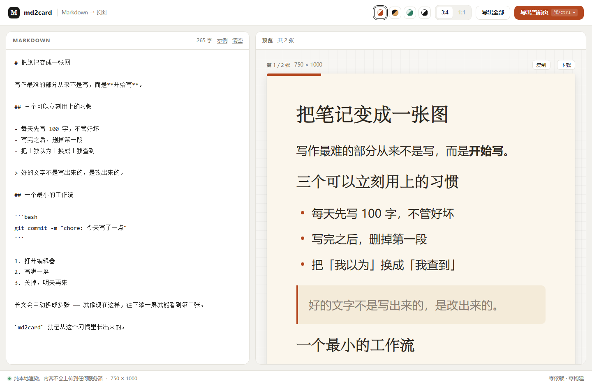
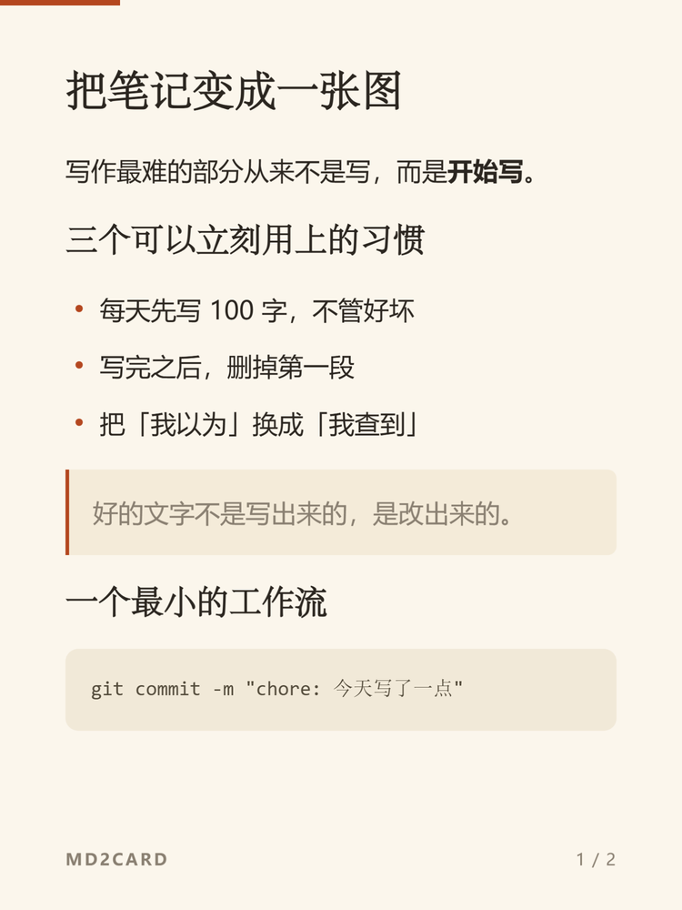

<div align="center">

# md2card

**把一段 Markdown，变成一张可以直接发出去的长图。**

纯前端 · 零依赖 · 零构建 · 内容不出浏览器

[](#)
[](LICENSE)

[在线体验](https://gehros.github.io/md2card/) · [设计取舍](#设计取舍) · [本地运行](#本地运行)



</div>

---

## 它做什么

左边写 Markdown，右边实时变成一张 750px 宽的卡片。内容太长会自动切成多张，每张都能单独下载成 PNG，或者直接复制到剪贴板。



不用打开设计工具，不用截图，不用上传到任何服务器。

<br clear="right" />

## 为什么做这个

我写作的地方是 Markdown，发布的地方却不是。每次写完一篇，还要把它搬到别的工具里重新排一遍版、调一遍间距、再截一张图——排版花的时间比写还多。

所以做了一个只做一件事的工具：**Markdown 进，图出**。

它没有登录、没有云端、没有模板市场。你写的东西连浏览器都不会离开。

## 特性

- **4 套主题**：纸感 / 墨黑 / 薄荷 / 极简，全部由 CSS 变量驱动，加一套只要 8 行
- **2 种尺寸**：3:4（图文流）和 1:1（方形封面）
- **自动分页**：按真实渲染高度贪心切分，并避免标题孤零零掉在页底
- **2x 高清导出**：750 × 1000 的卡片导出成 1500 × 2000 的 PNG
- **复制到剪贴板**：不支持 `ClipboardItem` 的浏览器自动降级为下载
- **草稿自动保存**：`localStorage`，刷新不丢
- **键盘流**：`Ctrl / ⌘ + Enter` 直接导出

## 设计取舍

这一节比功能列表重要。每个「没做什么」都是主动选的。

### 为什么不用 React

这个应用的全部状态是三个值：文本、主题、比例。没有路由、没有异步数据、没有跨组件共享。

引入框架要付出的是：一个 `node_modules`、一套构建流程、以及「双击打不开」的代价。而现在整个应用是 3 个文件 1186 行，改完存盘刷新即可。**状态越少，框架的收益越低。**

### 为什么不引 html-to-image / html2canvas

因为要分页。

`html2canvas` 这类库是把 DOM 重新「画」一遍，它对 CSS 的支持是残缺的；`html-to-image` 走 SVG `foreignObject`，质量好，但它把「截图」当成黑盒——而分页需要**精确知道每个块有多高**，这件事只能在真实布局里做。

所以这里自己拼那 40 行：把卡片 DOM 序列化进 `<svg><foreignObject>`，浏览器按矢量渲染，再画到 2x 的 canvas 上。好处是导出的结果和预览**逐像素一致**，坏处是必须自己保证 SVG 是合法 XML——`<br>` 得写成 `<br/>`，否则解析直接失败。

### 为什么只用系统字体

如果用 webfont，导出时必须把字体 base64 内联进 SVG 的 CSS 里，中文字体动辄 3–10 MB，base64 之后还要再涨三分之一。首屏加载和导出成功率都会崩。

所以四套主题全部使用系统字体栈（`PingFang SC` / `Microsoft YaHei` / `宋体`）。代价是不同系统上字形略有差异，收益是**导出成功率 100%，零网络依赖**。

### 为什么分页要测量，而不是按字数

标题、代码块、列表的行高完全不可预测。按字符数切，一定会在某一张图上切得很难看——而且这种难看是随机的，改一个字就可能换一个位置。

这里的做法是：把内容放进一个隐藏的、宽度和卡片正文完全一致的容器里真实渲染一遍，拿到每个块的 `offsetHeight`，再贪心装箱。

这个容器**必须是一个完整的 `.card`**，而不是一个裸的 `.card-body`——因为字号和行高定义在 `.card` 上，少了这一层，量出来的高度会腰斩。这是实现过程中踩得最深的一个坑。

### 还有两件小事

- **孤行控制**：打包时把「标题 + 紧随其后的那一块」当成一个整体判断，放不下就一起换页。10 行代码，去掉的全是「标题压在页底」这种一眼难看的断法。
- **导出用 `data:` 而不是 `blob:`**：直接双击打开 `index.html` 时页面是 `file://` 协议，`blob:` 继承的是不透明源，画到 canvas 上会污染它，`toBlob()` 直接抛 `Tainted canvases may not be exported`。`data:` URL 没有这个问题。

## 支持的 Markdown 语法

刻意只实现卡片场景真正用得到的子集——**不支持原始 HTML**，解析器永远不会输出用户写的标签，所以 `innerHTML` 注入这件事从根上不存在。

| 语法 | 支持 |
| --- | --- |
| `#` ~ `######` 标题 | ✅ |
| `**粗体**` `*斜体*` `~~删除~~` `` `行内码` `` | ✅ |
| `[文字](链接)` | ✅ |
| ```` ``` ```` 围栏代码（含 `~~~`） | ✅ |
| `>` 引用（内部可嵌套列表） | ✅ |
| `-` / `1.` 列表，一层嵌套 | ✅ |
| `---` 分隔线 | ✅ |
| 原始 HTML、表格、图片、脚注、任务列表 | ❌ |

段落内的单个换行会保留成换行——在卡片这种窄栏排版里，这比合并成空格更符合直觉。

## 已知限制

- 单个块比一整页还高时（比如很长的代码块），它会被裁掉，底部有一条渐隐提示。建议手动拆成两段。
- `file://` 协议下「复制图片」不可用（浏览器安全策略），会自动降级为下载。
- 卡片默认 750px 宽，窗口更窄时整体等比缩放，这是有意的——社交平台的规格是固定的。
- 没有撤销、没有版本历史。草稿只存最后一次。

## 本地运行

不需要 `npm install`，不需要构建。

```bash
# 方式一：直接双击 index.html

# 方式二：起一个静态服务器（推荐，导出/剪贴板行为更接近线上）
python -m http.server 8000
# 打开 http://localhost:8000
```

## 测试

```bash
node test/parser.test.mjs
```

39 条断言，覆盖解析器的各种边角（转义、嵌套列表、围栏代码、URL）和分页的装箱边界（含孤行控制）。

测试不依赖任何框架：它从 `app.js` 里按注释标记切出纯函数那两段再跑。这么做有点非常规，但换来的是**不用为了让代码可测而引入打包器**——对这个体量的项目，这个交换是划算的。

## 部署

纯静态，不需要构建——「把文件放上去，开一个开关」就完事。

1. 新建一个公开仓库，名字随意（示例用 `md2card`），**不要**勾选 “Add a README file”
2. 把项目文件拖进仓库页面的上传区域，提交
3. **Settings → Pages → Source** 选 **Deploy from a branch**，分支选 `main`，目录选 `/ (root)`
4. 等一分钟，`https://<你的用户名>.github.io/md2card/` 就能打开了

因为没有任何构建步骤，这里**不需要** CI：源文件就是产物，推上去即可访问。

## 目录结构

```
md2card/
├─ index.html          # 结构 + 卡片样式（<style id="card-style"> 会被导出时内联进 SVG）
├─ style.css           # 应用外壳样式
├─ app.js              # 解析器 / 分页 / 导出，全部逻辑
├─ test/
│  └─ parser.test.mjs  # 39 条断言，零依赖
└─ docs/               # README 配图
```

`app.js` 内部按五段组织：常量与状态 → Markdown 解析 → 测量与分页 → 渲染 → 导出。每段之间有注释分隔，测试脚本就是靠这些标记做切片的。

## License

[MIT](LICENSE)
